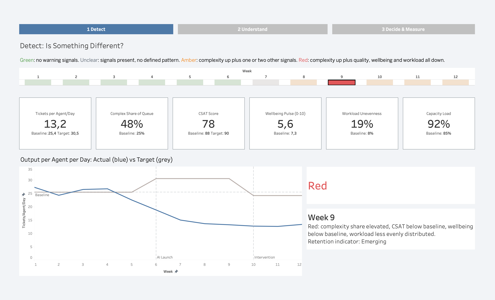
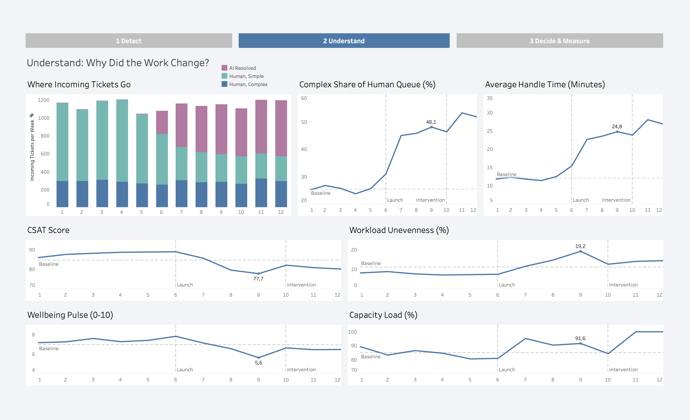
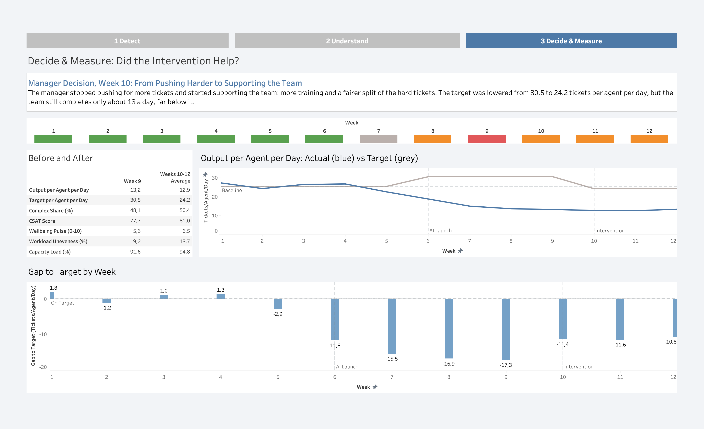

# Beyond the Target: Human Judgment in AI-Driven Operations

**A decision-support prototype that shows a manager what a productivity target cannot: how AI changes the work, and what that costs the team.**

When AI takes the easy work, what happens to human targets?

## Interactive Dashboard

**[Open the Dashboard on Tableau Public](https://public.tableau.com/views/BeyondtheTargetHumanJudgmentinAI-DrivenOperations/1Detect?:language=en-US&:sid=&:redirect=auth&:display_count=n&:origin=viz_share_link)**

The dashboard has three pages: **1 Detect**, **2 Understand** and **3 Decide & Measure**. On page 1, click any week in the status strip to update the six cards and the status panel.

> **All data in this project is simulated.** It was generated to test an idea, not collected from a real team.

### 1 Detect: Is Something Different?


### 2 Understand: Why Did the Work Change?


### 3 Decide & Measure: Did the Intervention Help?


## The Problem

Companies bring in AI to boost productivity and raise targets to match. But if AI takes over the easy work, what is left for people is harder, and a target based on raw output can stop telling the true story.

Recent research points the same way:

| Finding | Source |
|---|---|
| 96% of C-suite leaders expect AI to boost productivity, but 77% of employees using AI say it has added to their workload | Upwork Research Institute, 2024 |
| 47% of employees using AI say they do not know how to achieve the productivity gains their employers expect | Upwork Research Institute, 2024 |
| In an eight-month study at a technology company, AI adoption was associated with faster work, broader tasks and longer hours | UC Berkeley Haas researchers, 2026 |

These studies motivated the question. They do not test the scenario in this project.

## The Idea

**AI detects. Humans understand. Humans decide. AI measures the outcome.**

| Step | Question | Dashboard Page |
|---|---|---|
| Detect | Is something different? | 1 Detect |
| Understand | Why did the work change? | 2 Understand |
| Decide | What should the manager do? | 3 Decide & Measure |
| Measure | Did it help? | 3 Decide & Measure |

The dashboard never decides for the manager. It flags warning signs and shows the evidence. When the signals do not fit a defined pattern, it says **Unclear** instead of guessing.

## The Scenario (Simulated)

A nine-person customer support team over twelve weeks.

| Weeks | Phase | What Happens |
|---|---|---|
| 1-5 | Baseline | Normal work and original targets. Defines what is normal for this team. |
| 6 | Transition | An AI copilot launches and the per-agent target is raised by 20%. |
| 7-9 | Risky lever | The manager pushes for the target with no extra support. |
| 10-12 | Sustainable lever | The manager stops pushing, adds training, shares hard tickets more fairly and lowers the target. |

## Key Results (Simulated Data)

| Metric | Baseline (Weeks 1-5) | Week 9 | Weeks 10-12 Average |
|---|---|---|---|
| Output per agent per day | 25.4 | 13.2 | 12.9 |
| Target per agent per day | 25.4 | 30.5 | 24.2 |
| Complex share of the human queue | 25% | 48% | 50% |
| CSAT score | 88 | 78 | 81 |
| Wellbeing pulse (0-10) | 7.3 | 5.6 | 6.5 |
| Workload unevenness | 8% | 19% | 14% |
| Capacity load | 85% | 92% | 95% |

**Status by week:** Green (weeks 1-6), Unclear (7), Amber (8), Red (9), Amber (10-12).

After the manager changed course in week 10, quality, wellbeing and workload balance improved. Output did not recover and stayed about 11 tickets per agent per day below the target, and the team stayed close to capacity. In this scenario, the response bought **a more sustainable pace, not a faster one**.

## How the Warning Rules Work

Four warning signals, each compared with the team's own baseline (weeks 1-5 only):

| Signal | Fires When |
|---|---|
| Complexity | The complex share of the human queue is at least 10 percentage points above baseline |
| Quality | CSAT is at least 5 points below baseline |
| Wellbeing | The wellbeing pulse is at least 1.0 below baseline (0-10 scale) |
| Workload | Workload unevenness is at least 5 percentage points above baseline |

| Status | Rule |
|---|---|
| Green | No signals |
| Unclear | Some signals, but not a defined pattern |
| Amber | Complexity is elevated and one or two of the other signals fire |
| Red | Complexity is elevated and all three other signals fire |

The thresholds are **illustrative project rules**. They were fixed before the data was generated and are not statistically validated. Every week is exported with the signals that fired and a plain-English reason.

**Retention indicator (secondary):** for each week, how many of the last three weeks had both high complexity and low wellbeing. One week is "Emerging", two or three is "Sustained", and fewer than three weeks of history is "Insufficient History". It is a simple warning flag, not a prediction.

## Data and Method

- **Ticket flow:** tickets received, then AI resolves a growing share of the simple tickets from week 6, then the remaining tickets enter the human queue, then humans resolve what capacity allows, and any remainder carries over as backlog.
- **Capacity:** 360 working minutes per day, divided by average handle time, times 9 agents times 5 days. Resolved tickets never exceed capacity.
- **Handle time** reacts immediately to how complex the queue is. **Quality, wellbeing and workload unevenness** react about a week later, and the management response (pushing versus supporting) amplifies or softens the effect.
- **Baselines** use weeks 1-5 only. **Targets** are kept separate from baselines, because what the company wants and what is normal for the team are different things.
- **Checks:** notebook 01 verifies that ticket counts and backlog add up every week, that the capacity and per-agent formulas hold, and that resolved tickets never exceed capacity.

## Repository Contents

```
beyond-the-target/
├── README.md
├── notebooks/
│   ├── 01_data_generation.ipynb
│   └── 02_sql_aggregation.ipynb
├── data/
│   ├── team_weekly.csv
│   ├── team_weekly_long.csv
│   ├── team_weekly_status.csv
│   └── team_phase_summary.csv
├── tableau/
│   └── beyond_the_target.twbx
├── images/
│   ├── 1_detect.png
│   ├── 2_understand.png
│   └── 3_decide_and_measure.png

```

| File | Rows | Contents |
|---|---|---|
| `team_weekly.csv` | 12 | Every metric, target and baseline, one row per week |
| `team_weekly_long.csv` | 156 | One row per week and metric, for flexible charting |
| `team_weekly_status.csv` | 12 | Traffic-light status, the four signals, the reason and the retention indicator |
| `team_phase_summary.csv` | 3 | Phase averages (baseline, risky lever, sustainable lever), built with SQL |

## How to Run

Both notebooks run in Google Colab and work independently. Replace `YOUR-USERNAME` in the links below after you upload the repository.

1. **Notebook 01:** [](https://colab.research.google.com/github/YOUR-USERNAME/beyond-the-target/blob/main/notebooks/01_data_generation.ipynb)
   Choose **Runtime > Run all**. The last cell downloads `team_weekly.csv`, `team_weekly_long.csv` and `team_weekly_status.csv`. The random seed is fixed, so you get the same data every time.
2. **Notebook 02:** [](https://colab.research.google.com/github/YOUR-USERNAME/beyond-the-target/blob/main/notebooks/02_sql_aggregation.ipynb)
   Run the upload cell and choose `team_weekly.csv`, then run the rest. It builds `team_phase_summary.csv` with a SQL `GROUP BY` and downloads it.

Python libraries used: pandas, numpy, matplotlib and sqlite3.

## Tableau Notes

- The workbook (`tableau/beyond_the_target.twbx`) is a packaged workbook, so it includes its data. Open it in Tableau Public or Tableau Desktop.
- It uses `team_weekly.csv` and `team_weekly_status.csv`, related on `week`. Both have one row per week.
- Do not join `team_weekly_long.csv` to the status file. The long file has 13 rows per week, so a join would multiply every status row.
- `team_weekly_long.csv` and `team_phase_summary.csv` are included for flexible charting and the phase comparison. The final dashboards do not use them.

## Responsible Design

All outputs are at **team level**. No individual agent is tracked, scored or shown anywhere. Productivity per agent is a team total divided by a headcount. Annex III of the EU AI Act treats AI systems that monitor and evaluate the performance and behaviour of workers as high-risk, so staying at team level keeps this prototype on the safer side of that line. This is a design choice, not legal advice.

## Limitations

- **The data is simulated.** The mechanism (AI removes the easy tickets, so the remaining queue is more complex) was built into the data on purpose, so the dashboard has something to show. The results illustrate the approach. They are not findings about real teams.
- **Workload unevenness is modeled.** It is generated to rise with pressure as an assumption. It is not computed from ticket assignments, and the data has no per-agent information.
- **Thresholds are illustrative.** They were chosen as plausible manager rules, not validated statistically.
- **The retention indicator is not a prediction.** A one-agent departure in week 11 is flagged in the data as an illustrative event. No metric or calculation uses it.
- **One scenario.** The numbers come from a single simulated run.

**Next step:** test the approach on real, team-level data.

## Sources

- Upwork Research Institute (2024). [Upwork Study Finds Employee Workloads Rising Despite Increased C-Suite Investment in Artificial Intelligence](https://www.upwork.com/press/releases/upwork-study-finds-employee-workloads-rising-despite-increased-c-suite-investment-in-artificial-intelligence)
- UC Berkeley Haas (2026). [AI Promised to Free Up Workers' Time. UC Berkeley Haas Researchers Found the Opposite](https://newsroom.haas.berkeley.edu/ai-promised-to-free-up-workers-time-uc-berkeley-haas-researchers-found-the-opposite/)

## Author

**Elena Ingram**, final project for the Data Analytics program at WBS Coding School.

